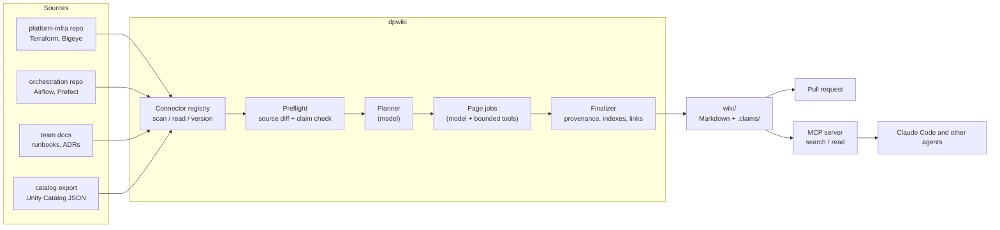
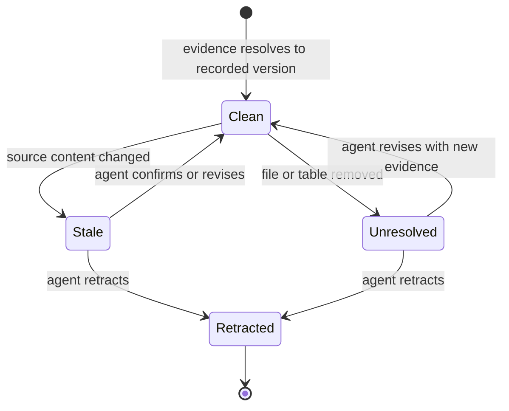
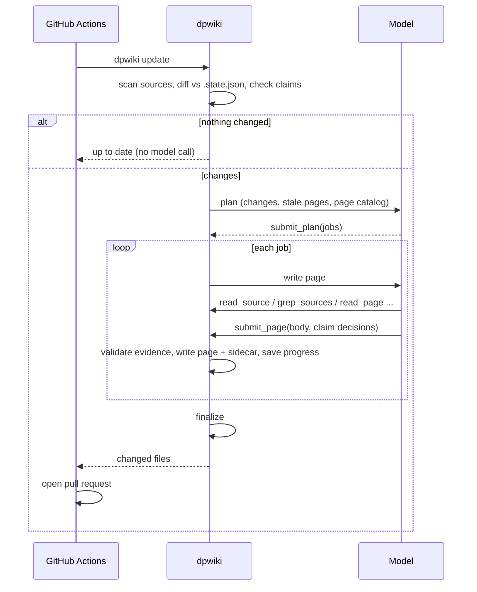

# Architecture

## Components



| Module | Job |
| --- | --- |
| `sources/` | Connectors. Each item has a URI and a content-derived version. |
| `claims.py` | Claim model, JSON sidecars, staleness check, add/confirm/revise/retract. |
| `wiki.py` | Page store with path rules. |
| `frontmatter.py` | Parse, validate, render, and repair page frontmatter. |
| `finalize.py` | Deterministic passes after the agent writes. |
| `search.py` | BM25 over page sections. No model. |
| `agent/runner.py` | Run lifecycle and resumable page jobs. |
| `agent/tools.py` | The only tools the model can call. |
| `agent/prompts.py` | Planner, writer, and ask prompts. |
| `mcp_server.py` | Read-only MCP tools for coding agents. |

## Claims and evidence

A claim is one checkable statement with one or more evidence URIs.

```json
{
  "id": "c-0fd88d9937a3",
  "statement": "The on-call rotation is dp-platform-oncall in PagerDuty.",
  "evidence": [
    {"resource": "src://team-docs/oncall.md#L3-L3",
     "version": "lines-v1:1:sha256:3be2..."}
  ]
}
```

Version tokens:

- `file-v1:sha256:<hash>` for a whole file.
- `lines-v1:<n>:sha256:<hash>` for a line range. If the same lines still exist anywhere
  in the file, the version is unchanged. Adding a header comment does not make claims stale.
- `table-v1:sha256:<hash>` for a catalog table's canonical JSON.



## Ownership of page fields

| Field | Owner |
| --- | --- |
| `type`, `title`, `description`, `tags`, `owner`, `status`, body | Agent or human author |
| `sources` | dpwiki, from claim evidence |
| `generated` | dpwiki, only when the body hash changed |
| `verified` | dpwiki, when the page was processed and all claims are clean |
| `index.md` between the dpwiki markers | dpwiki |
| `INSTRUCTIONS.md`, root index intro | Humans |

## Update run



## Ideas for the next iteration

- Connectors for Confluence, ServiceNow incidents, and Slack channel summaries, with
  facts from them kept as lower-confidence notes instead of claims.
- A Databricks job that writes the Unity Catalog export nightly, and a Snowflake equivalent.
- Ownership routing: request review from the page `owner` on the update PR.
- An eval set of on-call questions with expected pages, run in CI against `dpwiki ask`.
