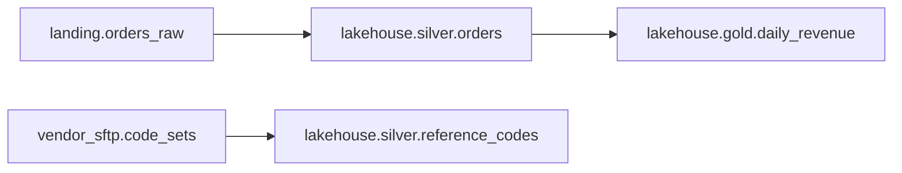

# Lakehouse Tables

Source: `catalog/unity_catalog_export.json`, a Unity Catalog export.

## Summary

| Table | Owner | Tier | Freshness SLA | Built by |
| --- | --- | --- | --- | --- |
| `lakehouse.silver.orders` | `data-platform-eng` | 1 | 26 hours | Databricks `silver_orders_merge` |
| `lakehouse.gold.daily_revenue` | `analytics-eng` | 1 | 30 hours | Snowflake `GOLD.BUILD_DAILY_REVENUE` |
| `lakehouse.silver.reference_codes` | `data-platform-eng` | 2 | 192 hours | Prefect `reference-data-refresh` |

## Lineage

## lakehouse.silver.orders

One row per order, merged daily from the landing zone. Domain: commerce.
Loaded by [orders_ingest](../orchestration/airflow-orders-ingest.md).

| Column | Type | Note |
| --- | --- | --- |
| `order_id` | string | Primary key |
| `customer_key` | string | Surrogate key, not PII |
| `order_ts` | timestamp | UTC |
| `amount` | decimal(18,2) | Order total in USD |
| `status` | string | placed, shipped, or cancelled |

## lakehouse.gold.daily_revenue

Revenue by day and status. Built in Snowflake and mirrored into the lakehouse.
Domain: commerce. Columns: `revenue_date` (date), `status` (string), `revenue_usd` (decimal(18,2)).

## lakehouse.silver.reference_codes

Vendor code sets refreshed weekly by
[reference-data-refresh](../orchestration/prefect-reference-data.md). Domain: reference.
Columns: `code_system`, `code`, `description` (strings), `effective_from` (date).

## Monitoring

Freshness monitors for orders and daily revenue are in
[Data Quality Monitoring with Bigeye](../data-quality/bigeye-monitors.md).
