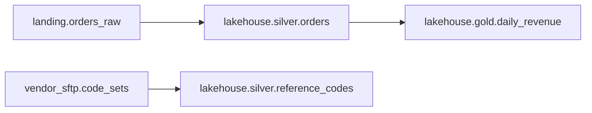

# Commerce and reference tables

Table metadata comes from the Unity Catalog export.

## lakehouse.silver.orders

- Owner `data-platform-eng`. Tier 1. Freshness SLA 26 hours.
- One row per order, merged daily by `silver_orders_merge` ([orders_ingest](../orchestration/airflow.md#orders_ingest)).
- Columns: `order_id` (primary key), `customer_key` (surrogate key, not PII), `order_ts` (UTC),
  `amount` (USD), `status` (placed, shipped, cancelled).

## lakehouse.gold.daily_revenue

- Owner `analytics-eng`. Tier 1. Freshness SLA 30 hours.
- Revenue by day and status. Built in Snowflake by `GOLD.BUILD_DAILY_REVENUE` and mirrored.

## lakehouse.silver.reference_codes

- Owner `data-platform-eng`. Tier 2. Freshness SLA 192 hours (8 days).
- Vendor code sets refreshed weekly by [reference-data-refresh](../orchestration/prefect.md#reference-data-refresh).
