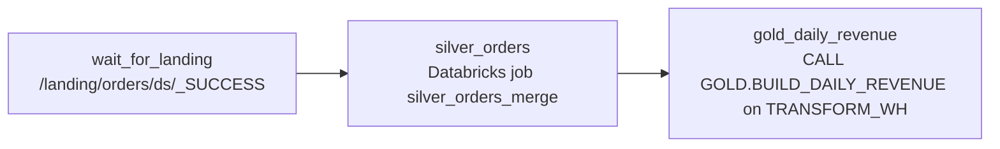

# Airflow

Airflow 2 runs on the managed environment `dp-airflow-prod`. Existing tier-1 pipelines stay
here until they migrate. New pipelines go to [Prefect](prefect.md) per
[ADR-003](../governance/adr-003-prefect-for-new-pipelines.md).

Connections such as `databricks_default` and `snowflake_transform` come from the secrets
backend, never from DAG code.

## orders_ingest

Tier-1 DAG that moves orders from the landing zone to Databricks silver and then to a
Snowflake gold table.

| Setting | Value |
| --- | --- |
| Schedule | `30 5 * * *` (05:30 UTC daily) |
| Owner | `data-platform-eng` |
| Retries | 3, 10 minutes apart |
| SLA | 4 hours |
| Concurrency | `max_active_runs=1`, `catchup=False` |
| Sensor | pokes every 5 minutes, times out after 3 hours, reschedule mode |

Outputs: [lakehouse.silver.orders and lakehouse.gold.daily_revenue](../catalog/commerce-tables.md).

## When it breaks

- Missed SLA on a tier-1 DAG is a SEV1. See [On-call](../runbooks/oncall.md).
- Re-running a date range: [Airflow backfill](../runbooks/airflow-backfill.md).
- Slow `gold_daily_revenue`: [Snowflake warehouse saturation](../runbooks/snowflake-warehouse-saturation.md).
